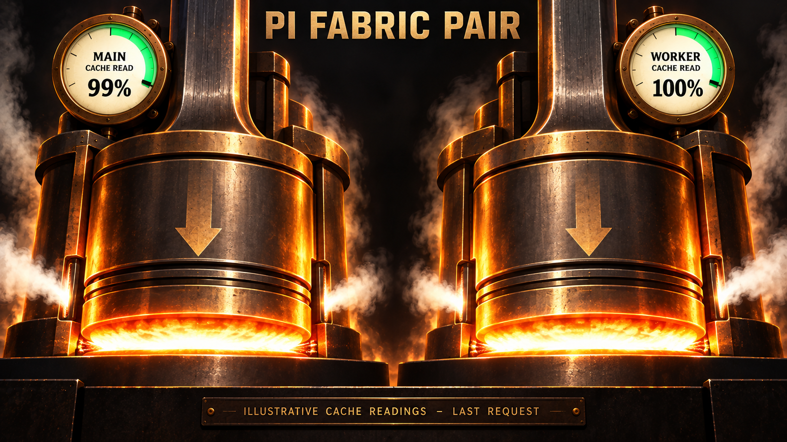
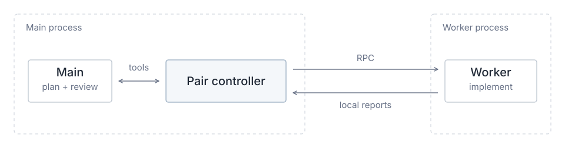
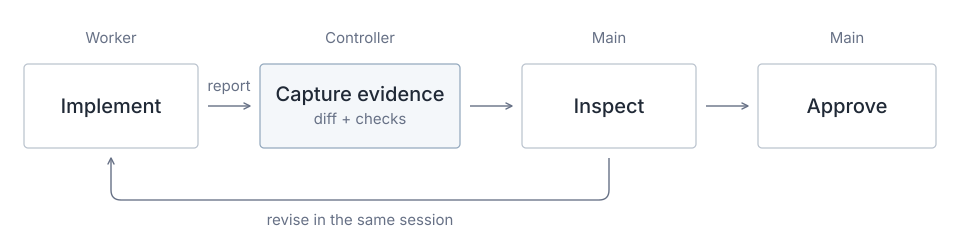
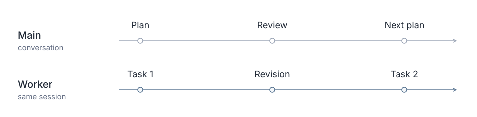

# pi-fabric-pair

**Your Main plans and reviews. A persistent worker builds.**



*Artwork shows illustrative cache readings.*

Pi Fabric Pair gives your [Pi](https://github.com/earendil-works/pi) session a
dedicated coding worker. Keep talking with Main while the worker implements a
bounded task. Main receives the result, inspects the code, and approves or asks
for changes. The worker keeps its conversation across revisions and tasks.

Both roles use your existing [Fabric](https://github.com/fabric-runtime/pi-fabric)
and [Fovea](https://github.com/monotykamary/pi-fovea) setup. Choose their models
separately.

```text
Main -- task ----------------------> Worker
Main <-- report + code evidence ---- Worker
Main -- answer / revise / approve -> same Worker
```

**Experimental MVP:** one Main, one writer, one unresolved assignment. Start in a
disposable Git workspace with manual startup and every-step review.

## How Pair works



Pair's controller runs inside Main's Pi process and manages one persistent worker
through Pi's JSONL RPC. The worker edits the Git workspace and saves reports
locally before Main is notified.

## Get started

You need **Node.js 24+**, Git, and Pi 1.1 to 1.3 with Fabric, Fovea, and an authenticated model.

### 1. Install

```sh
git clone https://github.com/asx8678/pi-fabric-pair.git
cd pi-fabric-pair
pi install "$PWD"
```

The extension runs directly from source and needs no `npm install`. Pi loads the
two Pi packages Pair imports (`@earendil-works/pi-coding-agent` and
`@earendil-works/pi-tui`) from the running Pi, never from this checkout (checked
against the extension loader of Pi 1.1 through 1.3), so the development
dependencies that `npm install` adds for the tests and static checks do not change
what Pair runs against. Open Pi in your implementation project's
Git working tree. Keep Pair state outside that tree; the default
`~/.pi/agent` location does this.

### 2. Prepare Fabric

Merge these fields into the worker's effective `fabric.json`:

```json
{
  "executor": { "shellHangMs": 0 },
  "agents": { "maxDepth": 0 }
}
```

Global defaults normally live in `~/.pi/agent/fabric.json`; trusted worker-project
settings can override them. These fields disable automatic background shell spill
and recursive agents. They affect Main too if it shares the profile; Fabric has no
per-process setting yet. Prewalk may stay enabled, but `prewalk.alwaysRearm` must
not be `true`: an auto-armed worker would hand its first edit to another model.
Keep native automatic compaction enabled. Pair checks this setup without editing
it; `/pair doctor` reports what is missing.

Fabric gives Pair's tools its default risk, `execute`. If your Fabric approval
policy asks for or denies some risk classes, classify Pair's tools in the same
`fabric.json`:

```json
{
  "capture": {
    "risks": {
      "pair_status": "read", "pair_inspect": "read",
      "pair_yield": "write", "pair_cancel": "write", "pair_report": "write",
      "pair_dispatch": "agent", "pair_decide": "agent", "pair_recover": "agent"
    }
  }
}
```

### 3. Start the worker

Open `/pair settings`:

| Setting (page) | Value when no settings file exists |
| --- | --- |
| Pair enabled (General) | Off — turn it on in General or with `o` on the dashboard |
| Start with each session (General) | On |
| Model and thinking effort (Workers) | No model, `medium` effort: choose an authenticated model and a supported effort |
| Review policy (Review) | `milestones`, with final review always required |

The settings screen is one framed panel over the chat. Every configuration field
in `fabric-pair.example.json` has a row on one of eleven pages, so the screen and
the file cannot drift apart:

| Page | What it holds |
| --- | --- |
| Workers | The roster first — one row per worker, the default starred — then, for the worker being edited, model, thinking effort, read-only and workspace, followed by Make default, Move up, Move down, Duplicate, Remove and Add a worker… last. Press Enter on a worker in the roster to edit it; the one being edited says `editing` before its model. With more than one worker an Editing row at the top of that block also chooses it. Order and membership change through the rows below the roster. |
| Review | Review policy, step size limit, revision limit, revisions per step, final review, report detail, and automatic report delivery. |
| Supervision | Main supervision, Main recoveries per task, the idle check-in, the step time limit, and the nineteen `control` rows: watchdog, silence before a ping, ping answer limit, tool time limit, step nudge, watchdog recoveries per step, auto-repairs per step, waits before a fallback, shell timeout limit, compaction time limit, compact before a task above, fresh session above, Main heartbeat and its interval, nudges without a report, steers per step, provider cooldown, quota cooldown and provider waits per step. |
| Limits | Step time limit, reports per task, report size limit, report repairs, and the optional cost and output-token ceilings (`none` by default). |
| Verification | The trusted commands (Enter opens the editor and asks for authorization), require passing, and the command time limit. |
| Peer review | Whether it runs, the reviewer model (through the same picker as the worker's), when it reads (`checkpoints` or `final`), and its time limit. |
| Runtime | Backend (`pi` or `low`), program and arguments, the low program and its arguments, extra and excluded extensions, extra skills, inherit extensions, MCP servers, and the startup, request and shutdown timeouts. |
| Requirements | Fabric, Fovea, Prewalk disabled and auto compaction. |
| Evidence | The file limit, snapshot size limit and per-file size limit. |
| Display | The indicator above the editor and the terminal attention cue. |
| General | Whether Pair is on, whether it starts with each session, worker slots in use, Main read-only during a task, Save to, Edit as JSON…, and a pending migration when one exists. |

`Tab`/`→`/`l` and `Shift+Tab`/`←`/`h` move between the pages (the tab bar
scrolls and keeps the current page visible); `↑`/`↓` move between the rows.
`Enter` changes the selected row: it opens a list of choices, a text field, or the
model search (type to filter). `Space` is the quick change: it flips an on/off
switch or steps to the next choice. Every change saves at once, so there is no
separate save step: a setting that was written says so in the status line, and a
change that cannot be saved says why, and the screen keeps showing the saved value.
Esc closes the screen. Save to decides which file an edit goes to: this project, or
the global defaults every project inherits.

Three more keys make the pages quick to work with:

- Each row shows where its value comes from — `default`, `global` or `project` —
  dimmed at the right edge. The tag is the first thing given up on a narrow
  terminal, and at 60 columns it is dropped so the value keeps its room.
- `r` resets the selected row: it removes that field from the current scope's file,
  so the value falls back to the other scope or to the default. It goes through the
  same merge path as any edit. A field this scope does not set is left alone, and the
  status line says which scope owns it.
- `/` filters the rows. The filter matches labels and key paths (`maxRevisions`,
  `control.silentMs`) across every page and lists the matches as one page with their
  page names; Enter jumps to the row and Esc clears the filter.

**Edit as JSON…** on General opens the current scope's file as formatted JSON in
your editor. It is validated with `validateConfigLayer` before anything is written:
an invalid or malformed layer is refused with the reason, the file stays byte for
byte untouched, and you are offered another attempt (which reopens on what you
typed). A valid layer is written through the normal save path and the screen
reloads from disk. The small `/pair settings` menu outside the TUI (no custom
views available) offers the same item; it stays deliberately short — the TUI screen
is the place where every field is editable.

Runtime, requirements, worker and evidence rows shape what the worker process
starts with, so their hint says they apply at the next worker restart; saving one
while a task runs adds that the change is staged.

While a worker holds a task, Main is read-only in the workspace — with one
exception: it may edit Pair's own configuration (`.pi/fabric-pair.json` and its
backups), because those files are outside the checkpoint's evidence and editing
them is how you retune Pair mid-task. Every other path stays blocked until the task
ends or Main owns the step through `pair_decide` action `"fix"`.

Then run:

```text
/pair start worker
/pair doctor
```

Startup checks readiness without requesting a model turn. Main's model stays
under `/model`.

Now ask Main:

> Use Pair's worker to make one small change. Inspect its diff and verification
> results, and ask me before approving it.

By default (`autoDeliverReports: true`) a finished report is delivered to Main
automatically once Main's current work is done, and never interrupts it. Review gates govern
Main's decisions; asking the human before each approval requires that explicit
instruction.

## Worker backends

The worker can be a Pi RPC process (the default) or a [low](https://github.com/asx8678/low) worker. Main stays the
same Pi + Fabric + Fovea session either way: review gates, checkpoints, evidence, decisions, steers and the
watchdog work exactly the same, and only the process that does the work changes.

The backend is chosen per worker, so one project can hold a Pi worker and a low worker at the same time:

| Setting | Meaning |
| --- | --- |
| `workers[].backend` | `"pi"` or `"low"` for that worker. Optional: without it the worker follows `runtime.backend`. |
| `workers[].lowCommand` | That worker's low binary. Optional: falls back to `runtime.lowCommand`. |
| `workers[].lowArgs` | That worker's arguments. Optional: falls back to `runtime.lowArgs`. |
| `runtime.backend` | The project default, `"pi"` unless you change it. |
| `runtime.lowCommand` | The default low binary, `low` on `PATH`. |
| `runtime.lowArgs` | Default arguments, placed before Pair's own `low --serve` arguments. |

A backend change is restart-bound for the worker that changed: the running generation keeps the backend it was
started with, and the new one applies at that worker's next start. The one-live-worker rule is unchanged, so a mixed
roster still runs one worker at a time: `/pair start <id>` stops an idle live worker and starts the other. In the TUI the Workers settings page has a **Backend** row (and the low command and arguments rows when it is
`low`); the dashboard roster and `/pair worker list` show each worker's backend; `/pair worker add <id>
[provider/model] [effort] [pi|low]` sets it when adding a worker.

**Provider fallbacks.** A worker may list providers to switch to when its own keeps failing:

```json
{ "id": "worker", "provider": "opendesign", "model": "deepseek-v4.1-flash", "effort": "high", "cwd": null, "readOnly": false,
  "fallbacks": [{ "provider": "opencode-go", "model": "deepseek-v4.1-flash" }, { "provider": "other", "model": "m", "effort": "low", "backend": "low" }] }
```

Up to four, tried in order. Each takes `provider` and `model`, and optionally `effort` and `backend`; anything it
leaves out is the worker's own. A run that ends without a report on a classified provider error switches at once for
a quota stop and after `control.fallbackAfterWaits` waits (2) for a rate limit; with every fallback spent, the
ordinary provider wait applies. The switch stops the process (a confirmed exit), records the fallback on the worker,
and resumes the step on it: a Pi worker keeps its conversation and is started with the fallback model, which its
authority and drift checks then expect; a low worker restarts `low --serve` on the fallback model with the same
`--session`. A fallback on the other backend cannot carry a conversation, so it starts a fresh one with the whole
plan, and the primary conversation is set aside. The switch is not a recovery and does not spend the recovery budget,
it is on the task's timeline and announced, and the roster shows the worker's fallback. It lasts for the task: the
next dispatch stops the worker and puts it back on its own provider and conversation. A read-only worker cannot fall
back to low. In the TUI the Workers page has a **Fallbacks** row (`provider/model`, optionally `:effort` and
`@pi`/`@low`) and the Supervision page a **Waits before a fallback** row.

A low worker cannot be read-only, and Pair does not check Fabric, Fovea, prewalk or compaction requirements for it;
`/pair doctor` still reports them for Main. The worker's own report arrives as the same latch and inbox file a Pi
worker's `pair_report` writes, so a checkpoint from low is reviewed like any other. The differences that matter
while running one — no in-worker tool gate, low's own `run()` sandbox, usage reported once per task — are in
[docs/low-backend.md](docs/low-backend.md).

## Everyday controls

| Command | Purpose |
| --- | --- |
| `/pair` or alt+w | Open the live dashboard; it lists what needs you first. |
| `/pair settings` | Open the settings screen: workers, review, supervision, limits, verification, peer review, runtime, requirements, evidence, display, scope, and Edit as JSON. |
| `/pair status` | A short read-out of state, task progress and observed usage; the legend and cache-warming details live in `/pair doctor`. |
| `/pair reload` | Reload saved Pair settings while Main stays open. |
| `/pair restart worker` | Reload settings and restart only the worker, keeping its conversation. Asks first while a task is running. |
| `/pair start [worker]` | Start the worker and continue its conversation. Naming another configured worker switches to it: an idle live worker is stopped first, and one holding a task refuses. |
| `/pair pause worker` | Pause the task and hold the worker. |
| `/pair resume worker` | Resume a paused or interrupted task. |
| `/pair report` | Read the current report as a card: Pair's own checks first, then the worker's claims (read-only; Main still inspects). |
| `/pair diff` | Scroll the checkpoint diff; `[`/`]` jump between files, `/` searches. |
| `/pair transcript worker` | Follow the worker transcript; `o` switches between one line per tool call and the full output. |
| `/pair inbox` | Inspect retained reports. |
| `/pair yield` | Explicitly send retained, unacknowledged reports to Main. |
| `/pair reconcile` | After a Main crash, prove the old worker process exited so the worker can be used again. |
| `/pair cancel worker` | Cancel the task and keep the conversation. |
| `/pair stop worker` | Stop the worker process and retain its history. |
| `/pair worker list` | Every configured worker in list order: the first is the default and is what a bare `/pair start` and a dispatch use, and a never-started one says "not started". |
| `/pair worker add <id> [provider/model] [effort] [pi|low]` | Add a worker slot (a bare model name inherits the first worker's provider). The backend is optional; `low` after the model and effort means the backend, while a lone `low` is still the effort. |
| `/pair worker remove <id> [keep\|discard]` | Remove a worker after confirming. `keep` (the default) leaves its conversation, so adding the same id later resumes it; `discard` deletes its session, inbox, archive and mesh. A worker that is running or holds a task is stopped first and its task cancelled (the confirmation says so; files it changed stay). Refused only for the last worker, or when Pair cannot prove the process exited. The list is edited in the file that holds it, project or global. |
| `/pair worker default <id>` | Move a worker first: a bare `/pair start` and a dispatch to a worker use the first entry. |
| `/pair reset-worker worker` | Start the next task in a new conversation (old session files are archived, not deleted). |
| `/pair indicator mode` | Choose the footer badge and live line: `minimal`, `compact`, `board` or `off`. |
| `/pair doctor` | Diagnose Pair, Pi and Fabric setup; also holds the key legend and the cache-warming explanation. |
| `/pair import-backup global\|project file` | Import retained Pair V1 limits from a `.v1.bak` file. |

You can configure several workers, but Pair runs one at a time. Starting a
worker that is not live — `/pair start <id>`, a dispatch to it, or `n` on the
dashboard — stops an idle live worker first, after asking; a worker that holds a
task is never displaced, and the refusal names it and its task. `n` on the
dashboard shows the same question as "Stop worker and start ds2? Pair runs one
worker at a time." Nothing about the lease, the attempt or the report and exit
fences changes with more than one worker: the worker that holds the lease is the
only one that can report, decide or write.

Restart keeps Main's model and session open. It asks first while the worker has an
open task, because restarting interrupts the current step (a worker with no task
restarts without a prompt). Interrupted work waits for explicit resume; staged
model changes require finishing or cancelling the current task.
Invalid configuration leaves the last valid settings in use.

A save never rewrites the file from the copy the session loaded. Immediately before
writing, Pair re-reads that scope's layer from disk and applies only the fields your
edit changed onto it, so a setting somebody else added to the file in the meantime
survives; if the file changed at all, the status line says so ("The file changed
outside this screen; your change was merged"). Editing the same field in the screen
wins over the external value, since that is what you are looking at. If the file has
become unreadable or invalid, the save is refused and the file is left byte for byte
untouched.

Pause and cancel ask first, from a command, the menu or the dashboard; stop asks
while a task is running. None of them undoes file changes. Normal Main shutdown also stops owned
workers; `/new`, `/resume` or a fork asks first while the worker is running.

`/pair` completes its own subcommands, configured worker IDs (second word of
start, stop, pause, resume, cancel, restart, report, diff, transcript, reconcile
and reset-worker) and the indicator modes, each with a one-line description. A
mistyped subcommand gets its closest matches: `Unknown Pair command "stpo". Did
you mean /pair stop?`, or up to three when several are equally close.

## The dashboard

Press **alt+w**, or type `/pair` with no arguments, to open the dashboard. It is
one live, framed panel over the chat: a rounded box around the worker's model and
state, the plan with the current step marked, the last checkpoint's Pair checks,
and the keys that apply right now.

With more than one worker configured, the panel opens with a **Workers** list: one
row per configured worker showing its id (the first marked `(default)`),
provider/model, effort, its state — the same liveness word the badge uses while a
process runs, otherwise `not started`, `stopped`, the error, or `EXIT_UNCONFIRMED` —
and the step it is on. The selected row carries `▸`, and everything you press acts
on that worker. `↑`/`↓` (or `j`/`k`) move the selection; `w` still cycles. A
single worker keeps the compact screen it always had, with no list to read. It updates in place — elapsed time, activity and state — while it
stays open, so you never reopen it to see change. The header line drops whole items
rather than cutting a word: it keeps the model, the state and `step 2/4`, and gives
up the context percentage, then the cost, then the elapsed time, then the effort,
before it truncates anything. The context percentage is only shown while the worker
process is running; a stopped or crashed worker's last reading would be stale, so
it is left out. A finished task's header also drops `step N/M`, because the Last
task line below already gives the count. On a wide terminal the overlay stays a readable
column of at most 100 characters, and on a short one it sheds detail before it
would hide the keys: first recent activity, then step history, then finished steps
fold into one `✔ 1–3 approved` row, and last the plan is cut after the current
step. The key hints wrap by whole hints, so a key never ends a line without its
label.

```
╭──────────────────────────────────────────────────────────────────────────────╮
│ Pair                                                                         │
│ claude-opus · high   ◉ working  3m12s · $0.14 · ctx 41% · step 2/3           │
│                                                                              │
│ Add retry and backoff to the fetch client                                    │
│ ✔ 1 Add retry policy type           approved                                 │
│ ▶ 2 Wire retries into fetch client  editing src/http/client.js · rev 1/3     │
│ ○ 3 Tests for backoff                                                        │
│                                                                              │
│   t transcript  p pause  c cancel  x stop  a add worker  s settings  m more  ? │
╰──────────────────────────────────────────────────────────────────────────────╯
```

| Key | Action (offered only when it applies) |
| --- | --- |
| `r` | Read the current report card. |
| `d` | Scroll the checkpoint diff. |
| `t` | Follow the worker's transcript (see below). |
| `y` | Send retained reports to Main now. |
| `p` | Pause a running task, or resume a paused or interrupted one; both ask first. |
| `c` | Cancel the task; asks first, then for a reason. The conversation and file changes are kept. |
| `↑` / `↓` | Select the previous or next worker; `w` still cycles. Every other key acts on the worker selected. |
| `n` | Start the selected worker. If another worker's idle process is live it is stopped first, after asking; a worker holding a task is never displaced. |
| `x` | Stop the selected worker's process; asks while a task runs. Its conversation is kept. |
| `a` | Add a worker: asks for an id, then the model picker, then the effort. |
| `D` | Remove the selected worker: choose to keep its conversation (adding the same id later resumes it) or discard it, which asks once more because it cannot be undone. A running worker is stopped first and its task cancelled; files it changed stay. Never the last worker. |
| `*` | Make the selected worker the default, which moves it first; a bare `/pair start` and a dispatch both use the first entry. |
| `!` | Reconcile: prove an old worker process exited after a Main crash, so the worker can be used again. Shown only when the last exit is unconfirmed. |
| `o` | Turn Pair on. Shown only while it is off, and the screen's own sentence names the same key. |
| `s` | Open the settings screen (the same one `/pair settings` opens). |
| `m` | More: `r` restart the worker (asks first while a task runs), `x` stop it (while it runs), `i` status, `b` inbox, `l` reload settings, `d` doctor. |
| `?` | List every key with what it does. Each description is a few words long, so it fits one line at the narrowest overlay. |
| `esc` / `q` | Close. In More and in the key list they step back to the dashboard. |

The plan also carries its short history: under each step you see what happened to
its reports and decisions, newest last and at most three per step, within a bounded
per-task timeline of the last 60 entries:

| History line | Meaning |
| --- | --- |
| `◐ Checkpoint · 2/2 Pair checks passed` | A report arrived and Pair's own checks passed. |
| `◐ Checkpoint · 1 Pair check failed` | The same, in amber, when a check failed. |
| `◐ Question` / `◐ Blocker` / `◐ Final review` | The report's kind, when no check ran. |
| `↻ revise: honour Retry-After on 429` | Main asked for changes; `↻ answer: …` is the same for a question. |
| `✔ approved` | Main approved the step. A finished step's own row already says "approved", so its history leaves this line out. |

A **Recent activity** section lists the worker's last few tool calls, newest last.

The transcript follows the worker's conversation as it happens: who speaks
(`◆ Pair`, `◆ worker`), the worker's own words, one `→` line per tool call naming
the tools it used, and one `←` line per result, or `✖` when it failed. Pair's long
task prompts are folded to their first lines. Press `o` to see every output in
full, over the last 40 messages, and `o` again to fold it. The view refreshes about every two seconds and
stays at the bottom; scrolling up pauses it, and scrolling back to the end (or
`G`) follows again.

Read-only screens (report, diff, transcript, status, inbox, doctor) return you to
the dashboard when they close, so two screens never stack. A single key is easy to
hit by mistake, so pause, resume, cancel and restart ask before they run (cancel
then asks for a reason), and stop asks while a task is running. Without a task the
dashboard is a readiness screen: it says what the worker is doing and offers the
next step as a key this screen actually has (choose a model, start the worker,
turn Pair on) — never a bare `/pair` command you already ran, and never a start
key that would fail: while Pair is off it offers only the settings key. `Pair is
off` is stated exactly once on every screen that can show it — as the readiness
sentence when there is no task, and as a line under the title when a plan or an
empty worker list is on screen. A task that already
ended leaves one line above it: `Last task  ✔ <objective> · 4/4 approved · 2m42s ·
$0.14`, or `Last task  ✖ cancelled at step 2/4 · <objective>`; the objective is
shortened before any number is.

### Attention cue (opt-in)

Turn on **Settings → Display → Attention cue** (`attentionCue: true`) if you want the
terminal to pull you back when a worker needs a person. While it is on, a state
that needs you — a worker error or EXIT_UNCONFIRMED, a permission dialog, a
stalled worker, a paused or interrupted task, or reports that cannot reach Main
because automatic delivery is off — prefixes Pi's title with a short reason:

```
! pair · permission dialog — π - my-project
```

The bell rings once for each new event: a second worker in trouble, or a
worker that needs something different, rings again, but a stalled worker does not
ring every minute it stays silent; its title keeps the idle time current
instead. In a real terminal the bell is a BEL written to stdout only when stdout
is a TTY, so pipes and rpc output stay clean. As soon as nothing needs you the
title returns to Pi's own format (`π - <project>` or `π - <session> - <project>`),
and Pair restores it on shutdown and when you turn the cue off. Renaming the
session keeps the prefix, with the new name. It is off by
default and only ever touches the title and the bell: review, question and
blocked stay quiet, because those wait for Main.

## How a report reads in the chat

A report arrives as a card that keeps what Pair verified apart from what the
worker says. It sits on the same background as Pi's own custom messages.
Collapsed it is at most six lines, and when expanding would show more, its first
line ends with Pi's expand key, as Pi's collapsed tool output does:

```
◐ Checkpoint · step 2 · peer review: concerns (ctrl+o to expand)
  Added backoff with jitter; 429 honours Retry-After.
Pair verified  ✔ typecheck  ✖ test (exit 1)
Worker claims  3 reported pass, not verified
  4 files · src/http/client.js, src/http/retry.js, test/retry.test.js, …
⚠ STEP_TOO_LARGE: this every-step checkpoint changes 4 files (limit 2).
```

**Pair verified** comes only from the checks Pair ran itself, with the exit code
or `(timed out)`, or `none configured` when the project defines none. **Worker
claims** are the worker's own report and are always labelled *not verified*.
Amber marks what needs attention — a failed check, a step-size or budget warning,
a peer review that reported concerns. A question or blocked report leads with its
question, so you can answer it without expanding; expanding restores the files
row and adds the full summary, every changed file, all worker-reported checks, the
peer review's findings, and the report ID with the checkpoint hash.

A question or blocked card leads with its question:

```
◐ Question · step 2 (ctrl+o to expand)
  Should retries apply to POST requests, or only to idempotent GET and PUT?
Pair verified  ✔ typecheck
Worker claims  1 reported pass, not verified
```

Pair's other chat cards use the same vocabulary: `◐ Pair notice` and `◐ Pair
check` mean Main has something to handle, and `⚠ Pair supervision` means a worker
problem. A `✔` marks a passing check or a finished task, never a notice.

## Status at a glance

Pi draws every extension's status text on one shared footer line, so Pair keeps
its part to a small badge and puts the detail above the editor where it can use
the full width. The badge is steady (it never blinks) and never repeats the step
title:

| Badge | Meaning |
| --- | --- |
| `pair ◉ 2/4 3m` | Working on step 2 of 4, three minutes into the task. |
| `pair ◉ starting` | The worker process is starting. |
| `pair ◐ 2/4 review` | A checkpoint waits for Main; Main reviews it, not you. |
| `pair ◐ 2/4 question` | The worker asked Main a question. |
| `pair ◐ 2/4 blocked` | The worker is blocked; Main handles it. |
| `pair ◐ 2/4 final` | Final review waits for Main. |
| `pair ! attention` | The worker errored or vanished; the line above the editor says why and points at `/pair`. |
| `pair ! permission` | The worker is waiting on a permission dialog. |
| `pair ! idle 6m` | No worker activity for six minutes: read `/pair transcript`. |
| `pair ! 2 reports` | Reports are retained and automatic delivery is off: run `/pair yield`. |
| `pair ⏸ 2/4 paused` | The task is paused and waits for `/pair resume`. |
| `pair ⏸ 2/4 interrupted` | The worker was interrupted (crash, stop or an external abort); `/pair resume` continues. |
| `pair ✔ 4/4 done` | Every step is approved; its plan board folds them into one `✔ 1–4 approved` row. It settles to `pair ● ready` after about ten minutes. |
| `pair ● ready` | The worker is idle and ready for the next task. |
| `pair ○ set up` | No worker model is chosen yet: open `/pair`. |
| `pair ○ off` | Pair is off or the worker is stopped. |
| `pair w1 ◉2/4 w2 ●` | One short entry per worker once several are configured, named by worker id (clipped at ten columns) and painted in that worker's own colour. A worker that needs you leads the badge, and the ones that do not fit under 32 columns fold into `+N`. |

Amber and red are reserved for states that need you; review, question and blocked
stay calm because Main handles them. Choose what sits above the editor with
`/pair indicator <mode>` or **Settings → Display → Indicator**:

| Mode | Shows |
| --- | --- |
| `minimal` (default) | The badge plus one live line with a progress bar, the labelled step (`step 2/4`), activity, elapsed time, step revisions and cost. |
| `compact` | The badge only. |
| `board` | The badge plus a plan board: one row per step, with finished steps collapsed when the plan is long, then one compact row per other busy or attention-needing worker (`◐ w2 1/2 Split logger · review`). |
| `off` | Nothing. Commands and the attention cue still work. |

```
■■■▣▣□□□□□ step 2/4 · ▶ Wire retries into fetch client · editing client.js · 3m12s · rev 1/3 · $0.14/$2.00
```

The bar fills `■` for approved steps and `▣`, in the step's color, for the step
under way. The count is labelled `step 2/4` so it cannot be read as `2 approved`;
it falls back to the bare `2/4` only once the bar itself is gone, after every
lower-ranked part has dropped. A finished plan's clock stops when the last step is
approved, and it shows no activity, no step revisions and no streaming speed: only
its elapsed time and cost stay, because nothing is in flight. A paused or interrupted
task's clock stops while it is held, at the moment it was held, and the alert next to
it counts the wait instead (`paused 12m · /pair resume`). Pair does not subtract the
held time afterwards: once the task resumes, the clock again shows the time since the
task started. The line clears with
the `✔` badge about ten minutes later; a cancelled task clears at once.

The step title is the point of the line, so it is protected: while the title would
have to fall below 40 columns, the line drops a measured number instead, lowest
priority first (speed, cache, cost, step revisions, elapsed time). Only then does
the title shrink, down to its 16-column minimum, and only then do activity and the
title go. An alert (stalled worker, permission dialog, near-full context, a reached
limit, or failed Pair verification) keeps its place while anything else can go,
and it outranks the bar itself: the line narrows the bar — down to the bare count —
before it gives up an alert, and only then the step title.
Activity names the file rather than its path (`editing client.js`), and a command
target stays as typed.

A step that waits says what it waits for, with the same words on the live line, the
board and the dashboard: `review by Main`, `final review by Main`,
`question for Main` and `blocker for Main`, and `paused` or `interrupted` for a
held task. On the live line the word is its own part at the activity's rank, so it
drops only after the measured numbers; a paused or interrupted task already carries
an alert there and adds no word of its own.

A worker that needs you and has no plan for you to watch still gets one line above
the editor: `! worker needs attention · <short error> · open /pair` (`! w2 ...`
when several workers are configured). Here a slash command is right, because the
line sits above the editor rather than inside `/pair`. Board mode shows the same
alert rows the live line raises — a failed Pair check, a reached limit, the step
revision cap, a nearly full context, a crashed or stalled worker, a permission
dialog — and an attention row adds the short error and the next step:
`⚠ worker needs attention · Worker exited unexpectedly (code 1) · /pair`.

### `/pair status` and `/pair doctor`

Status is a short read-out, not a manual. It shows each worker's state and model,
the task with its progress bar (`■■▣□ step 2 of 4 · 1 approved`), one row per step
with the symbol alone (`✔ 2. Wire retries into fetch client`), Main's state, and the
details worth keeping. Rows with no reading are left out: no `— tok/s`, no
`last read unknown`, no context line without data. The Activity section describes
work in flight, so an idle, stopped or crashed worker never shows the tool it ran
minutes ago; the live line, the board and the dashboard drop the same stale tool. A
stalled worker still shows what it is stuck on. One short
line points at `/pair doctor`, which carries the key legend and the full native
cache-warming explanation, and adds the Fabric, Fovea and configuration checks it
needs for a bug report.

## Review you can inspect

Approval is tied to an inspected code checkpoint. Source changes after that
checkpoint invalidate approval.

Answering a question and requesting a revision do not need that exact match: you or
Main may edit the workspace while a report waits. Pair captures the workspace as it
is when the decision is made, returns the changed files as `workspaceChanged`, gives
the worker the same list with an instruction to read and keep them, and fences the
worker's renewed lease on that capture, so a further edit before it starts refuses
the decision (`STALE_CHECKPOINT`) instead of handing the worker a workspace nobody
decided on. The next checkpoint is still measured from the last approved step, so it
includes those edits.

Pair's own configuration is never part of that evidence. The project config files
(`.pi/fabric-pair.json`, and the legacy `.pi/pair.json`), the `.v<version>.bak`
backups `saveConfig` writes next to them, and anything else named
`.pi/fabric-pair*` are excluded from every checkpoint, so editing your Pair
settings during a task neither shows up as a changed file nor makes a waiting
report stale. A report frozen before this exclusion still approves while nothing
but those files differs: the comparison recomputes its snapshot hash without them. A
task whose base snapshot was frozen before this exclusion is projected the same way
before the checkpoint diff, so its manifest never reports your config as a file the
worker deleted.
Everything else in the repository — including Fabric's own `.pi/fabric.json` — is
worker evidence as before.



After reporting, the worker waits. The controller lets execution settle, runs
configured checks, and captures the source evidence. Reports wait in Pair's
durable inbox and, by default, are delivered to Main automatically once Main's
current work is done: at the end of its current run, or as a new turn if Main is
idle. A report never interrupts Main, never rides on your prompt, and never takes
your prompt's place; if the two collide, your message is sent first. With
`autoDeliverReports: false` they never wake Main. Main can always call `pair_yield` to
receive every unacknowledged report (repeat reads return the same reports until
inspected or decided); a yield that found nothing arms one settlement-boundary
delivery for a late result, and anything later stays retained until the next
explicit review. Humans can always use `/pair yield` or `/pair inbox`. After a
branch navigation, Main re-inspects a pending report before deciding. Main
inspects the checkpoint and approves, revises, or cancels. Revisions continue in the same worker session;
final approval completes the task and retains that session.

Add project checks under **Settings → Review → Verification commands**.
Failed checks block approval when `requirePassing` is enabled. An empty command
list means no independent checks ran.

## Context, warming and cost



Main and Worker keep separate conversations. Include relevant constraints in
each work order; the worker does not inherit Main's private chat. Native Pi/Fabric
manages compaction, while Pair retains task state separately.

`/pair status` shows each role's **cache** reading (for example `last read 99.2%`):
the share of measured input read from provider cache on that role's last request. A role
with no measurement simply has no row; status never prints a placeholder.
The live line adds the worker's reading (`cache 31%`) only when it falls below 50%.
The hero artwork's 99-100% values are examples; actual results vary.

Native warming does nothing in a Pair session yet: Pi (through 1.3.0) stops its
warmer once Pair's messages are in context, so it sends no refreshes for either
role. `/pair doctor` prints this explanation in full, along with the key legend
and the native setting it read. Pair's support takes effect on a Pi that sends
them.
There, with `"cacheWarming": "idle"` in Pi's global settings, Pair keeps Main's
cache warm while the worker works and the worker's cache warm while its report
waits for Main, using Pi's own savings rule. Pi warms only models it knows a cache
lifetime for (built in: Anthropic only), so Pair gives any other model whose cache
reads cost less than its input a 4-minute lifetime before it runs, and never
changes one Pi already knows. A model with no cache-read price is never warmed,
because each refresh would bill the whole prompt and save nothing. Pair never warms
a Codex model, or an OpenAI Responses model used through a ChatGPT sign-in,
because Pi cannot cap that refresh; `/pair doctor` says when Main or the worker
uses one. Pi stops 30 minutes after a session's last request. Fabric's
`cache.hold` (Fabric 0.97.0 or newer, on a Pi with scoped warming) is a separate
paid opt-in for Main. Pair holds no leases and never changes Pi's settings. Pair's
inference budgets exclude Main usage and warming.

## Supervision, watchdog and steering

Main owns review, but it is not the only thing watching the worker. Every scan asks
the same questions in the same order, and each answer has a bounded, configurable
action attached to it.

**Liveness.** The runtime records the last event time (streaming deltas, tool updates,
dialogs and appended entries all count), the oldest running tool with its start time,
any provider retry in flight, the last provider error, and the start of a compaction.
Pair projects that into one state per worker: `starting`, `streaming`, `tool`,
`retrying`, `compacting`, `dialog`, `silent`, `idle` or `stopped`. `silent` means
the task is running, the runtime says it is not idle, nothing has arrived for
`control.silentMs`, and no tool, retry, compaction or dialog is in progress. The
dashboard's activity line uses the same projection, so a busy worker reads `running
bash 15m` and a genuinely quiet one reads "no activity".

**What each scan checks.** After every scan, `pair_status` reports for each worker its
liveness (state, last event age, tool in flight, retry, last provider error) alongside
the task, and `pair_peek` adds the live detail: the step and its elapsed time, recent
activity, its last words, context usage, and the steer and recovery budget left. The
scan also:

- delivers a finalized report, or holds it when the delivery cap is spent and asks
  Main to `pair_yield` it instead;
- checks a due provider retry (in the task, so it survives a restart);
- pauses a step that reaches `limits.activeStepTimeoutMs` (30 min by default);
- interrupts a run that ended without a report;
- leaves a task unresolved but visible: idle Main is woken once per task state.

**The recovery ladder.** Every rung below is recorded as a timeline note and a
notification, and each is bounded. None of them touches a human pause, a spent cost or
token budget, or an unconfirmed process exit.

| Trigger (default) | Action | Budget | When the budget is spent |
| --- | --- | --- | --- |
| No `pair_report` at the end of a run | interrupt, then re-prompt the worker | 1 re-prompt per step (`control.noReportNudges`) | interrupt is held, human warned, Main supervised |
| Step runs 20 min (`control.stepNudgeMs`) | steer: report what remains | once per step attempt, no recovery spent | hard pause below takes over |
| One tool runs 15 min (`control.toolMaxMs`) | abort the tool, re-activate with guidance | 1 recovery | Main supervised |
| No event for 5 min (`control.silentMs`) | one `get_state` ping | 1 ping per silence episode | — |
| Ping unanswered | stop the process, restart, re-activate | 1 recovery | Main supervised, exit unconfirmed for the human |
| Silent for 10 min but answering (2 × silentMs) | abort the stalled request, re-activate | 1 recovery | Main supervised |
| Rate-limit or quota error with no report | wait, then resume on its own | 4 waits (`control.maxProviderWaits`); transient 60 s doubling to at most 15 min, quota 15 min | Main supervised |
| Same, on a worker with `fallbacks` | switch to the next fallback and resume | a quota stop at once; a rate limit after 2 waits (`control.fallbackAfterWaits`) | the ordinary wait above |
| Process gone, exit proven | re-activate with recovery guidance | 1 recovery | Main supervised |
| Step reaches `activeStepTimeoutMs` (30 min) | pause for review | — | human decides |

Automatic recoveries are capped at 2 per step (`control.maxAutoRecoveriesPerStep`);
nudges and provider waits do not count against it. A crash, or an exit that cannot be
proven to have happened, is never recovered automatically: `pair_recover` tries to
prove it first, and otherwise the task stays held for you and `/pair reconcile`.

**Destructive commands are refused inside a Pi worker.** A worker that tried to run `git commit`, `git push`,
`git reset --hard`, `git checkout --`, `git clean -f`, `git rebase`, `git stash`, `git branch -D`,
`npm publish` (or pnpm/yarn/bun), `sudo`, or `rm -rf /` / `rm -rf ~` is stopped before the command runs, and told
which rule matched so it can report instead of retrying. The same check covers a `fabric_exec` program, whose
nested `pi.bash` calls bypass the earlier gate: a literal command is checked, and a command built at run time is
refused rather than run unguarded. The list is `control.blockedCommands` (regexes, matched against the whole
command and against each `|`, `&&` or `;` clause), and it is config-only — edit it in
`fabric-pair.json`, not in the settings screen. `control.defaultShellTimeoutS` (600, `0` disables it) is the
shell timeout limit: a call with no timeout of its own gets it, a direct call asking for more is cut to it, and a
`fabric_exec` program asking for more is refused with the limit named, so the worker sends it again within it. Both
are control settings, so tuning them never rebinds a worker. **A low worker has none of this:** its sandbox is the
only guard for shell work (see `docs/low-backend.md`).

**A hung command is not run again unchanged.** Most worker hangs are not a frozen worker but a command that never
ends: a test waiting forever, a server started in the foreground. In Pair's own records no worker command needed
more than about seven minutes, and every one that ran past ten was hung; the worker's habit was to rerun it with a
longer timeout. So every work order carries a short COMMANDS rule (bound every command, give test runners a per-test
timeout, never run servers or watch modes in the foreground, and on a Pi worker the limit above), a shell result
that ended in its own timeout gets a note telling the worker it hung and not to rerun it unchanged, and the
watchdog's message after it stops a tool at `control.toolMaxMs` says the same. This repository's own `npm test`
runs with `--test-timeout=60000 --test-force-exit`: the first fails a hanging test with its name, and the second
ends the run even when that test left a timer or a child process behind (without it the run still hangs).

**Mechanical failures go back to the worker, not to you.** Some failures are not
judgement calls: Pair ran the configured checks and one failed, the checks describe a
different workspace than the checkpoint, or an every-step checkpoint changed more files
than `supervision.maxStepFiles` allows. For those the report is not delivered at all.
Pair sends the same step back to the same worker with its own finding and the failing
output, up to `control.autoRepairsPerStep` times (2 by default) per step, and records
each attempt on the task's timeline as a watchdog action. These repairs are Pair's, not
yours: they do not spend `maxRevisions`, `maxRevisionsPerStep` or any of your revision
caps, and a question, a blocked report, a worker's own failure or an out-of-scope write
is never repaired this way — those still come to you. Once the budget is spent the report
reaches you as usual, and its message says how many repairs were tried and what each one
found, so nothing is hidden. The budget is outside `configHash()`, so tuning it never
interrupts a running worker.

**Compaction between runs.** Fabric compacts its worker context right after a run
settles. Pair treats that compaction as maintenance, not stray work: it lets it finish
(`control.compactionMaxMs`, 10 min by default; `0` refuses it) and the report settle
clocks, checkpoint freezing and the next prompt all wait for it. Stopping it would mean
a 1M-token worker never compacts and every request stays slow.

**Context hygiene between tasks.** A task never starts in a context that is
already too large. Before a dispatch sends the work prompt, Pair reads the worker's own
last measurement — Pi's bridge-probe context, or low's `status.json` prompt tokens — and
compares it with two thresholds:

- `control.compactBeforeTaskTokens` (200k by default, `0` off): the worker compacts
  first, keeping what the next task needs. A low worker cannot be told to summarise its
  own session, so it starts a fresh session instead — the same outcome by the route that
  backend has.
- `control.freshSessionAboveTokens` (600k by default, `0` off): the conversation is
  replaced rather than summarised. The old session file is archived under the worker's
  directory and the entry is kept in its history, so nothing is lost and the next task
  starts clean.

Both are `control` settings, so they are outside `configHash()` and tuning them never
interrupts a running worker. A worker Pair has never measured is left alone rather than
compacted on a guess, and a compaction is bounded by `control.compactionMaxMs` like any
other maintenance. The Settings screen's Supervision page has a row for each.

**What reaches Main, and what reaches you.** Every stop reaches both.

| Message | Sent when | To |
| --- | --- | --- |
| `FABRIC PAIR SUPERVISION` | a task stopped or stalled and Main may recover it | Main |
| `FABRIC PAIR NOTICE` | the same, with `mainSupervision` off: facts only, no recovery | Main, without waking it |
| `FABRIC PAIR CHECK` | idle Main has unfinished work, or Pair holds a report it will not deliver | Main |
| `FABRIC PAIR HEARTBEAT` | opt-in, while a task runs and Main is idle | Main |
| warning toast | every automatic stop, pause, wait, nudge and recovery | you |

**Looking and steering.** `pair_peek({workerId})` reads a worker without disturbing
it: live state, step and elapsed time, recent tool activity, its last words, context
usage, and the steer and recovery budgets left. `pair_steer({workerId, taskId, message})` queues an
instruction into the run that is already going — redirect it, or ask it to report now —
fenced to the current running lease and bounded per step (`control.maxSteersPerStep`,
6). `/pair steer <workerId> <text>` is the human's door to the same fence. Neither
starts a run or cancels one; do not poll them.

**Caps scale with the plan.** `policy.maxRevisions` (20) and
`limits.maxReportsPerTask` (40) are floors, not ceilings: a task gets at least two
revisions per step and enough deliveries for every step's per-step allowance
(`maxRevisionsPerStep` + 2 each), so a long plan cannot stall on a cap written for a
short one. The dashboard and `pair_status` show the effective numbers.

**Escaping a step limit.** At a step's per-step revision limit (3 by default) Main can
re-plan that step — `pair_decide` `revise` with `steps` that replace it, at most twice
per step position — or fix it directly: `action: "fix"` hands the workspace to Main,
and `action: "fixed"` runs the configured verification, freezes the result and
continues the worker with a note listing the files Main changed.

**A step can carry its own controls.** Besides `acceptance`, a step may declare a
`scope` — repository-relative globs (`src/**`, `test/*.test.js`) — and an `effort`.
An absolute path or a `..` in a scope is refused when the plan is dispatched or
revised. A checkpoint that changed files outside the scope is reported with a
`STEP_SCOPE` notice; with `supervision.enforceStepScope` on, a Pi worker cannot
write outside it and an approval of such a checkpoint is refused (a low worker has
no in-worker gate, so it is always the notice). A per-step `effort` is applied to a
Pi worker before its prompt and restored afterwards; a low worker serves one effort,
so a step asking for another level is refused with that reason rather than run at
the served one. A report may carry `acceptance: [{criterion, met, evidence}]`, which
the report card shows as a met count and, expanded, one verdict per criterion; low's
`criteria` and its second look map into the same field.

**The heartbeat** is opt-in and off by default. `control.mainHeartbeat: "note"`
appends one display-only line every `control.mainHeartbeatMs` (15 min) while a task
runs and Main is idle — state, step, step time, last event age and context — and
`"wake"` also starts a turn asking Main to `pair_peek` and act only on problems.

**Where the settings live.** Everything above is in `/pair settings` → Review:
Main supervision, Main recoveries per task, Check in when Main is idle, Step time
limit, Watchdog, Silence before a ping, Tool time limit, Step nudge, Watchdog
recoveries per step, Compaction time limit, Main heartbeat and Heartbeat interval.
They are stored under `control` in [the config](fabric-pair.example.json) and none of
them changes `configHash()`, so tuning them never interrupts a running worker.

## More details

Pair provides workflow controls; OS and tool permissions remain your security
boundary. Bounded automatic recovery exists (see above): each rung has a configurable
budget, is recorded in the task timeline and reaches either Main or you. Unattended
operation without any human — multiple concurrent writers included — remains outside
this MVP.

A worker model with a ~1M-token context compacts late, so its requests get slower and
more expensive for a long time before Fabric's threshold fires. Lower the threshold
with Pi's `compaction.modelOverrides` rather than waiting for it, and keep
`control.compactionMaxMs` generous enough for the compaction to finish.


`npm test` runs the repository's own suites (plain `node --test` over
`test/**/*.test.js`; nothing outside `test/` is collected) offline, in temporary
directories, with fake Pi RPC hosts in place of real workers. The UI suites cover
the parts that are pure functions of data: the task projection the UI reads
(including tasks saved before newer fields existed), the badge, live line, board,
dashboard, transcript and chat cards rendered from fixed summaries, the dashboard
and transcript views driven by keypresses against fake controllers, the attention
cue, and a harness smoke test that loads `src/ui.js` with Pi's TUI packages. The
controller, worker and runtime suites cover the handoff fences, report delivery
and recovery, verification and evidence, worker restarts, startup checks, RPC
framing and settings ([test/README.md](test/README.md)). They do not drive a live
session or a real model, so still run the static checks (`npm run typecheck`,
`npm run pack:check`) and review behaviour by hand.

[Example config](fabric-pair.example.json) | [MIT license](LICENSE)
